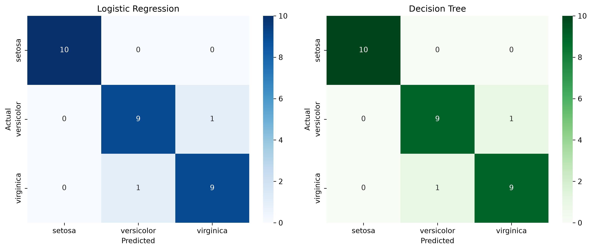
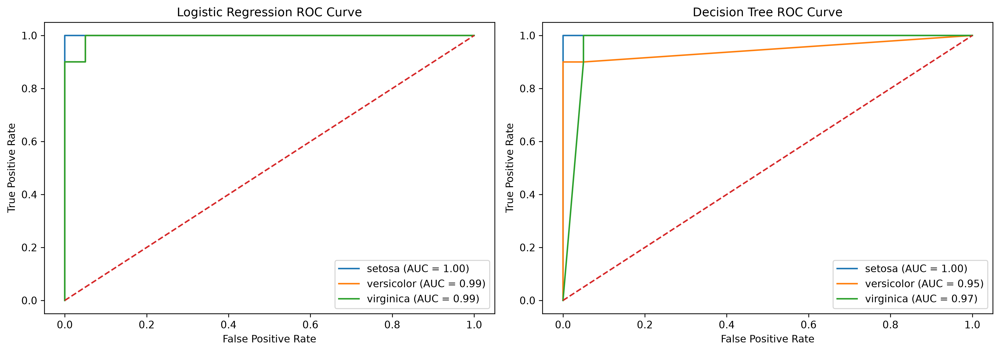
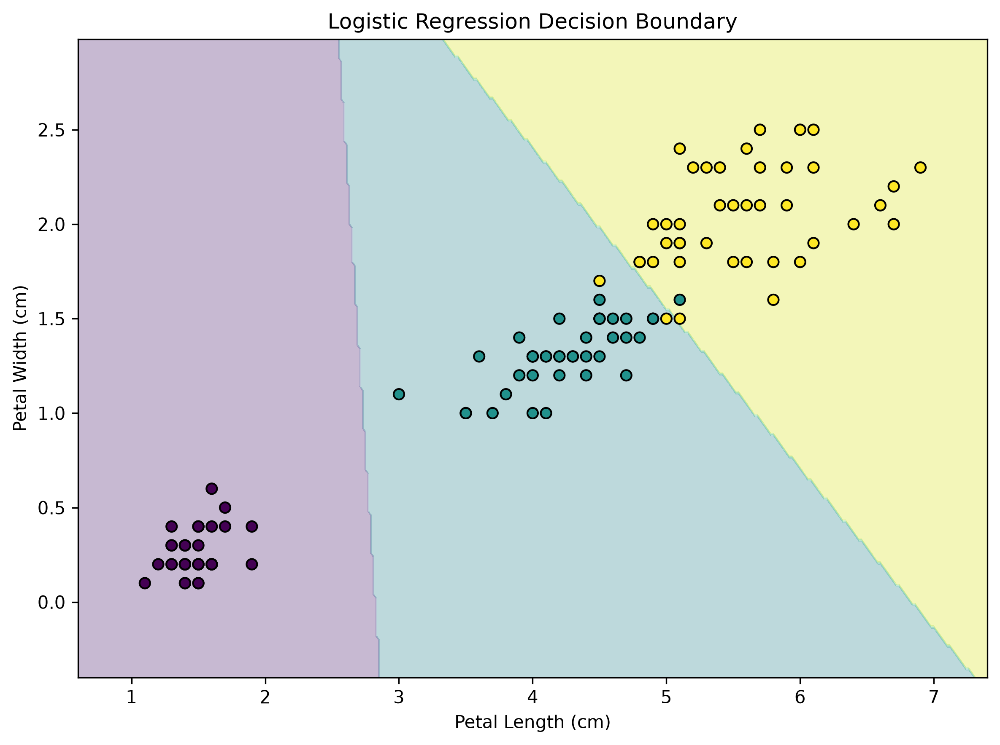
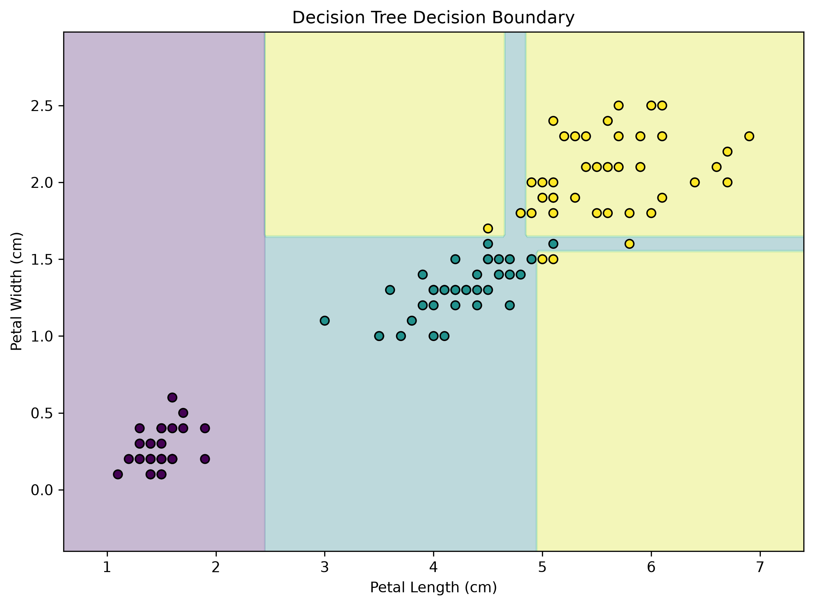

# Multi-Class Benchmark Classification Pipeline

## Project Overview

This project implements and compares two supervised machine learning classification algorithms using the Iris flower dataset.

The objective is to classify flowers into three species:
- Setosa
- Versicolor
- Virginica

## Technologies Used

- Python
- Pandas
- Scikit-Learn
- Matplotlib
- Seaborn
- Jupyter Notebook

## Machine Learning Models

1. Logistic Regression
2. Decision Tree Classifier

## Methodology

1. Load and explore the Iris dataset.
2. Examine missing values and statistical summaries.
3. Split the dataset into 80% training and 20% testing.
4. Apply StandardScaler to the training features.
5. Train Logistic Regression and Decision Tree models.
6. Evaluate both models using accuracy, precision, recall and F1-score.
7. Generate confusion matrices and ROC curves.
8. Visualise model decision boundaries.

## Experimental Results

| Metric | Logistic Regression | Decision Tree |
|---|---:|---:|
| Accuracy | 93.33% | 93.33% |
| Macro F1-score | 93.33% | 93.33% |
| Macro ROC-AUC | 0.9967 | 0.9733 |

## Conclusion

Both models achieved 93.33% accuracy and macro F1-score on the test dataset.

Logistic Regression achieved a higher macro ROC-AUC of 0.9967 compared with 0.9733 for Decision Tree.

Based on these results, Logistic Regression demonstrated stronger overall class discrimination on this experimental test split.

## Visual Results

### 1. Confusion Matrices

These matrices compare the actual and predicted Iris flower classifications for both models.



### 2. ROC Curves

The ROC curves show how well each model distinguishes between the three Iris species.



### 3. Logistic Regression Decision Boundary

This plot shows how Logistic Regression separates the Iris species using petal length and petal width.



### 4. Decision Tree Decision Boundary

This plot shows how the Decision Tree model separates the Iris species using the same two features.



## Installation

Clone this repository:

```bash
git clone YOUR_GITHUB_REPOSITORY_URL
```

Navigate into the project directory:

```bash
cd datheon-ml-internship
```

Create a virtual environment:

```bash
python -m venv .venv
```

Activate it on Windows PowerShell:

```powershell
.\.venv\Scripts\Activate.ps1
```

Install dependencies:

```bash
python -m pip install -r requirements.txt
```

Launch Jupyter:

```bash
python -m jupyter notebook
```

## Project Structure

```text
datheon-ml-internship/
├── task_01_iris_classification.ipynb
├── requirements.txt
├── README.md
└── .gitignore
```

## Author

Datheon Machine Learning & Data Science Internship

Project: Task 1 - Iris Classification
